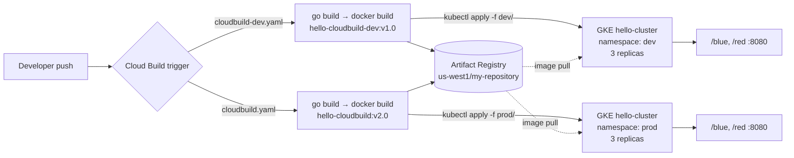

# sample-app – Go Web Service with a GKE CI/CD Pipeline

> A minimal Go HTTP service that serves solid-colour PNG images, containerised with a multi-stage distroless Docker build and shipped to separate `dev` and `prod` namespaces on Google Kubernetes Engine through Cloud Build.

<p align="left">
  
  
  
  
  
</p>

---

## Features

- **Tiny Go web server** using only the standard library (`net/http`, `image/png`); listens on `$PORT` (default `8080`).
- **Two image endpoints** – `/blue` and `/red` each return a 100×100 PNG filled with that colour, plus `/healthz` for Kubernetes probes.
- **Secure multi-stage Docker build** – compiled in `golang:1.19.2`, shipped as a static binary on `gcr.io/distroless/base-debian11`, running as `nonroot`.
- **Environment-specific pipelines** – `cloudbuild-dev.yaml` and `cloudbuild.yaml` run the Go tests, build and push the image to Artifact Registry, write the build's `$PROJECT_ID` into the manifests, and `kubectl apply` the `dev/` or `prod/` directory.
- **Kubernetes manifests** – 3-replica Deployments with readiness/liveness probes on `/healthz`, and LoadBalancer Services on port `8080`, for development (`dev/`) and production (`prod/`).

## Tech Stack

| Area | Technology |
|------|------------|
| Language | Go (standard library only) |
| Container | Docker multi-stage build, distroless base image |
| CI/CD | Google Cloud Build |
| Registry | Google Artifact Registry (`us-west1`) |
| Orchestration | Google Kubernetes Engine (`hello-cluster`), `kubectl` |

## Architecture



## Project Structure

```
sample-app/
├── main.go              # HTTP server: /blue, /red PNG handlers and /healthz
├── main_test.go         # Handler tests (go test)
├── go.mod               # Module hello-app, Go 1.19
├── Dockerfile           # Multi-stage build → distroless, non-root image
├── cloudbuild-dev.yaml  # Dev pipeline: build, push, deploy to namespace "dev"
├── cloudbuild.yaml      # Prod pipeline: build, push, deploy to namespace "prod"
├── dev/
│   ├── deployment.yaml  # Dev Deployment (3 replicas, probes) – image hello-cloudbuild-dev:v1.0
│   └── service.yaml     # dev-deployment-service (LoadBalancer :8080)
└── prod/
    ├── deployment.yaml  # Prod Deployment (3 replicas, probes) – image hello-cloudbuild:v2.0
    └── service.yaml     # prod-deployment-service (LoadBalancer :8080)
```

## Getting Started

### Run locally with Go

```bash
git clone https://github.com/Gonugunta-Venkata-Jayanth/sample-app.git
cd sample-app
go test ./...
go run .                 # listens on :8080
PORT=9000 go run .       # or any port via $PORT
```

### Run with Docker

```bash
docker build -t hello-app .
docker run --rm -p 8080:8080 hello-app
```

Then open http://localhost:8080/blue or http://localhost:8080/red.

### Deploy with Cloud Build (GKE)

Prerequisites: a GKE cluster named `hello-cluster` in `us-west1-a` with `dev` and `prod` namespaces, an Artifact Registry Docker repository named `my-repository` in `us-west1`, and the Cloud Build service account allowed to deploy to GKE.

```bash
# Development
gcloud builds submit --config cloudbuild-dev.yaml .

# Production
gcloud builds submit --config cloudbuild.yaml .
```

The manifests contain the literal token `$PROJECT_ID` in their image paths. The "Set project ID in manifests" step replaces it with the Cloud Build project before `kubectl apply -f dev/` (or `prod/`), which creates both the Deployment and its LoadBalancer Service. To apply them by hand:

```bash
export PROJECT_ID=my-gcp-project
sed "s|[$]PROJECT_ID|$PROJECT_ID|g" dev/deployment.yaml | kubectl -n dev apply -f -
kubectl -n dev apply -f dev/service.yaml
kubectl -n dev get service dev-deployment-service   # EXTERNAL-IP:8080/blue
```

## API Endpoints

| Method | Path | Response |
|--------|------|----------|
| GET | `/blue` | `image/png` – 100×100 solid blue square |
| GET | `/red` | `image/png` – 100×100 solid red square |
| GET | `/healthz` | `200 ok` – used by the readiness and liveness probes |

```bash
curl -o blue.png http://localhost:8080/blue
```

## Future Work

- Tag images with `$SHORT_SHA` instead of fixed `v1.0` / `v2.0` versions
- Add an Ingress with TLS instead of a raw LoadBalancer Service
- Add resource requests/limits and a HorizontalPodAutoscaler

## Author

**GV Jayanth** – [GitHub @Gonugunta-Venkata-Jayanth](https://github.com/Gonugunta-Venkata-Jayanth)
