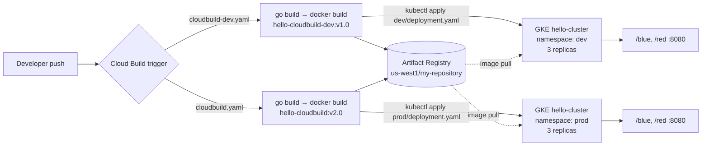

# sample-app – Go Web Service with a GKE CI/CD Pipeline

> A minimal Go HTTP service that serves solid-colour PNG images, containerised with a multi-stage distroless Docker build and shipped to separate `dev` and `prod` namespaces on Google Kubernetes Engine through Cloud Build.

<p align="left">
  
  
  
  
  
</p>

---

## Features

- **Tiny Go web server** using only the standard library (`net/http`, `image/png`) on port `8080`.
- **Two image endpoints** – `/blue` and `/red` each return a 100×100 PNG filled with that colour.
- **Secure multi-stage Docker build** – compiled in `golang:1.19.2`, shipped as a static binary on `gcr.io/distroless/base-debian11`, running as `nonroot`.
- **Environment-specific pipelines** – `cloudbuild-dev.yaml` and `cloudbuild.yaml` compile, build, push to Artifact Registry and `kubectl apply` to the `dev` or `prod` namespace.
- **Kubernetes manifests** – 3-replica Deployments for development (`dev/`) and production (`prod/`).

## Tech Stack

| Area | Technology |
|------|------------|
| Language | Go (standard library only) |
| Container | Docker multi-stage build, distroless base image |
| CI/CD | Google Cloud Build |
| Registry | Google Artifact Registry (`us-west1`) |
| Orchestration | Google Kubernetes Engine (`hello-cluster`), `kubectl` |

## Architecture



## Project Structure

```
sample-app/
├── main.go              # HTTP server: /blue and /red PNG handlers
├── Dockerfile           # Multi-stage build → distroless, non-root image
├── cloudbuild-dev.yaml  # Dev pipeline: build, push, deploy to namespace "dev"
├── cloudbuild.yaml      # Prod pipeline: build, push, deploy to namespace "prod"
├── dev/
│   └── deployment.yaml  # Dev Deployment (3 replicas, port 8080)
└── prod/
    └── deployment.yaml  # Prod Deployment (3 replicas, port 8080)
```

## Getting Started

### Run locally with Go

The repository has no `go.mod` (the Dockerfile creates one at build time), so initialise a module first:

```bash
git clone https://github.com/Gonugunta-Venkata-Jayanth/sample-app.git
cd sample-app
go mod init hello-app
go run main.go
```

### Run with Docker

```bash
docker build -t hello-app .
docker run --rm -p 8080:8080 hello-app
```

Then open http://localhost:8080/blue or http://localhost:8080/red.

### Deploy with Cloud Build (GKE)

Prerequisites: a GKE cluster named `hello-cluster` in `us-west1-a` with `dev` and `prod` namespaces, an Artifact Registry Docker repository named `my-repository` in `us-west1`, and the Cloud Build service account allowed to deploy to GKE.

```bash
# Development
gcloud builds submit --config cloudbuild-dev.yaml .

# Production
gcloud builds submit --config cloudbuild.yaml .
```

> The image paths in `dev/deployment.yaml` and `prod/deployment.yaml` reference a specific Google Cloud project ID; update them to your own `PROJECT_ID` before deploying. The manifests create Deployments only; expose them with a Service (e.g. `kubectl expose deployment ... --type=LoadBalancer --port 8080`) to reach the app.

## API Endpoints

| Method | Path | Response |
|--------|------|----------|
| GET | `/blue` | `image/png` – 100×100 solid blue square |
| GET | `/red` | `image/png` – 100×100 solid red square |

```bash
curl -o blue.png http://localhost:8080/blue
```

## Future Work

- Commit a `go.mod` and pin the Go version
- Add a Kubernetes `Service` / Ingress and readiness/liveness probes (e.g. a `/healthz` endpoint)
- Read `PORT` from the environment (the Dockerfile sets it, but the server always listens on `8080`)
- Parameterise image tags with `$SHORT_SHA` / `$PROJECT_ID` instead of fixed versions and project IDs
- Add unit tests for the handlers and a test step in Cloud Build

## Author

**GV Jayanth** – [GitHub @Gonugunta-Venkata-Jayanth](https://github.com/Gonugunta-Venkata-Jayanth)
